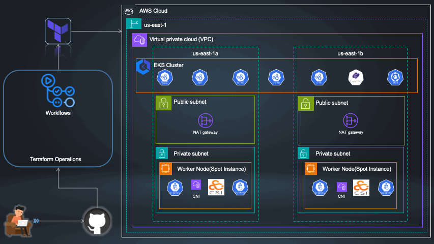

# 🚀 Configuring Production-Ready EKS Clusters with Terraform and GitHub Actions

Welcome to the repository for **Configuring Production-Ready EKS Clusters with Terraform and Automating with GitHub Actions**! This repository accompanies my blog post and demonstrates the practical steps to set up and automate an EKS cluster.

**Refrance Totorial .**

## 🌟 Overview
This project covers:
- **Infrastructure as Code (IaC)**: Use Terraform to define and manage your EKS cluster.
- **CI/CD Automation**: Leverage GitHub Actions to automate deployments.

## 📄 License
This project is licensed under the Apache 2.0 License. See the [LICENSE](LICENSE) file for details.

